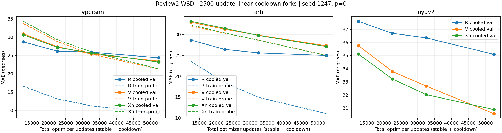
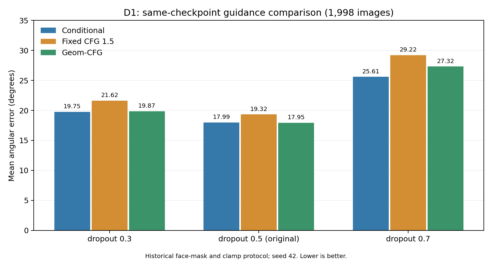
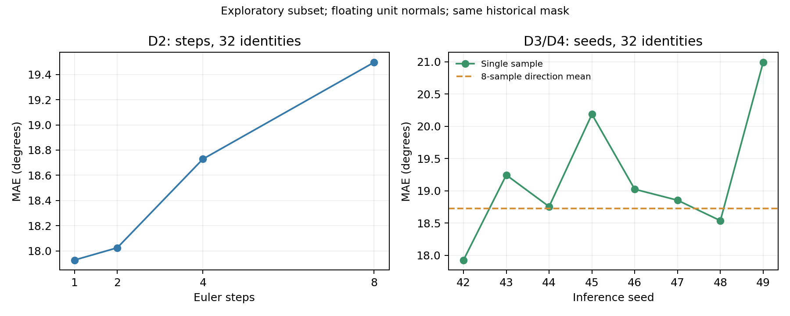

# FNFlow

Pixel-space conditional Flow Matching for face normals, with isolated research code for general object and indoor-scene normal estimation.

This repository contains the historical UNet baseline, experiment code and aggregate numerical results. **Single-seed R/V/Xn WSD convergence diagnostics are complete through 50k stable updates plus 2.5k cooldown. The former24-run/review2 rules are archived historical diagnostics; no multi-training-seed generalization result is claimed.** Future public updates are limited to code/configuration, operational instructions and aggregate results.

## Latest completed object comparison (2026-10-24)

Completed inference-only evaluation of Neural LightRig and existing52,500-update R/V/Xn checkpoints. No new training. MAE degrees, lower is better; object macro.

| Dataset (objects/images) | Neural LightRig | R | V | Xn |
|---|---:|---:|---:|---:|
| gso (198/792) | 20.2410 | 30.4605 | 30.9454 | 29.9913 |
| arb (128/384) | 29.9299 | 25.6840 | 28.1681 | 28.1133 |
| diligent (10/10) | 28.9285 | 26.7426 | 25.9474 | 27.6081 |
| luces (14/14) | 21.7068 | 25.1059 | 26.1473 | 24.7425 |

[Full aggregate JSON](results/object_comparison_20261024/summary.json) includes both macro aggregations, main/secondary GT, strict pixel thresholds, boundary coverage, inference-seed sensitivity, paired-object counts, GT disagreement and efficiency. [Pinned protocol and component hashes](configs/object_comparison_release_20261024.json).

[Full measurement conditions and aggregate tables](results/object_comparison_20261024/README.md). The old24-run/review2 budget rules below are archived diagnostics, permanently retired for this object scope; they are not unlocked by this release. No new training was performed.

## Contents

- [Historical baseline](baseline/)
- [Full results](results/D1_full/summary.json)
- [Pilot results](results/P0_D1_D5_pilot/summary.json)
- [Full eight-seed results](results/D2_D3_full_multiseed/multiseed_summary.json)
- [Publication scope](PUBLICATION.md)
- [Completed WSD convergence tables](results/P2_wsd_convergence_review2/cooled_results.md)
- [Completed WSD aggregates](results/P2_wsd_convergence_review2/summary.json)

## Completed WSD diagnostic snapshot

Training seed 1247, condition dropout p=0, the same 256px center-square data and UNet; no DINO, ray inputs or CFG. Each final model has 50,000 stable updates plus an independent 2,500-update linear cooldown. MAE in degrees is macro-averaged over valid images and two paired image-specific inference replicates (42, 43), not over training seeds.

| Method | Hypersim, 700 images | Arb, 594 views / 198 assets | NYUv2 validation, 795 images |
|---|---:|---:|---:|
| R | 24.3455 | 24.9713 | 35.1048 |
| V | 23.4378 | 27.3166 | 30.5735 |
| Xn | 23.2017 | 27.1311 | 30.8801 |

The registered budget status is `inconclusive_still_improving`; some registered cells continue to improve by more than 0.3 degrees at the cap. No common formal budget is approved. Xv has a matched 2,500-update clipping diagnostic only, not a completed long run. [Complete tables](results/P2_wsd_convergence_review2/cooled_results.md) include all four cooled budgets, boundary errors, noise sensitivity, material-subset counts and clipping. [JSON](results/P2_wsd_convergence_review2/summary.json) also includes training-probe metrics, source hashes and independent aggregate reconciliation. These results have one training seed, no confidence intervals and no GSO model scores.

## First diagnostic results

UNet-B has 43,081,539 parameters. Full FaceScape diagnostics use 1,998 images and the historical face-mask protocol. The original best result is reproduced at **17.899513816 degrees**. These are historical development-domain results, not object/scene generalization results.

| Training checkpoint | Conditional | Fixed CFG 1.5 | Geom-CFG |
|---|---:|---:|---:|
| dropout 0.3 | 19.7527 | 21.6212 | 19.8666 |
| dropout 0.5, original | 17.9906 | 19.3185 | 17.9513 |
| dropout 0.7 | 25.6053 | 29.2225 | 27.3178 |

Mean angular error in degrees; lower is better. A checkpoint trained without condition dropout is evaluated only conditionally.

Step-count, eight-seed and averaging diagnostics use a fixed **32-identity pilot**, not all 1,998 images. They show remaining noise dependence and do not establish calibrated uncertainty.

## Full eight-seed follow-up

The follow-up uses the fixed p05_best checkpoint, all 1,998 historical images and inference seeds 42–49. Each score is first averaged over images, then over seeds. SD is the sample SD of the eight dataset MAEs (ddof=1), not training-seed variation or a generalization confidence interval. Identical initial fields are paired across step counts; the historical evaluator resets a seed per image.

| Inference | Euler steps | Float-normal MAE mean ± seed SD, degrees |
|---|---:|---:|
| Geom-CFG | 1 | 19.2632 ± 1.0382 |
| Conditional | 1 | 19.5688 ± 1.1633 |
| Conditional | 2 | 19.8400 ± 1.4971 |
| Conditional | 4 | 20.2608 ± 1.9732 |
| Conditional | 8 | 20.5925 ± 2.3104 |

All 40 configurations completed. Per-seed aggregate scores and paired step differences are in the linked JSON. No sample identifiers or per-image results are added by this follow-up release.

## Image-specific noise follow-up

Same fixed checkpoint and full 1,998-image set, one Euler step, eight inference replicates. A versioned SHA256 of the base seed and dataset-relative RGB key derives a different initial field for each image. The fields are paired across guidance modes; the historical shared-field results above are retained.

| Inference | MAE mean ± dataset-replicate SD, degrees | Mean within-image MAE SD, degrees | Mean pixel angular dispersion, degrees |
|---|---:|---:|---:|
| no_cfg | 19.8371 ± 0.0199 | 1.3500 | 3.3175 |
| geom_cfg | 19.4122 ± 0.0202 | 1.3228 | 4.0873 |

The dataset-replicate SD measures Monte Carlo variation of the dataset mean. Within-image MAE SD and pixel directional dispersion measure noise sensitivity; they are distinct statistics. Displayed SDs use ddof=1. None is training-seed SD or a generalization confidence interval. Pixel dispersion is the mean angle to the directional sample mean within each evaluation mask, then macro-averaged over images.

[Aggregate results](results/D3_full_imagewise_noise_v1/multiseed_summary.json) include the shared-field reference and the mean directional variance 1-R. Sample keys, seed mappings and per-image records are not exported.

## Directional averaging and identity resampling

Same full historical set and image-specific noise. Existing checkpoints are kept separate; neither was retrained.

| Checkpoint | Conditional MAE° | Geom-CFG MAE° | Geom-CFG ensemble of 8 MAE° | Single-sample Geom-CFG identity interval° |
|---|---:|---:|---:|---|
| p05_best | 19.8371 | 19.4122 | 18.9568 | [19.1502, 19.6764] |
| p05_original | 19.1481 | 19.2544 | 18.7597 | [18.9852, 19.5327] |

Intervals are 95% percentile cluster-bootstrap intervals: 100 identities resampled 10,000 times, conditional on the fixed weights, inference draws and development-domain identity population. Whole clusters are sampled and the macro-image ratio is recomputed. They do not include training-seed variation or establish generalization to new domains. Eight-sample directional averaging costs eight samples and changes the estimator; its gain is not an isolated irreducible noise cost.

[Aggregate results and paired intervals](results/D4_D6_face_supplements_v1/aggregate_summary.json).

## Data preparation status

The existing Hypersim conversion contains 7,325 samples; 3,146 images have at least one zero normal inside the old valid mask. A new native-geometry FP32 cache contains 5,736 train and 700 validation images from 30/5 disjoint scenes. All prepared samples pass the included loader checks. Exact camera projection matrices are retained; an ordinary K has a separate validity flag. RGB comes from lossy final-preview images, not the original HDR color.

The first comparison does not use ray inputs, DINO or CFG. Official NYUv2 scene metadata and train/test indices are checked: 795 images from 249 rooms are reserved for real-indoor validation, with no room overlap with the 654-image test partition. All 795 packaged RGB/normal/K validation pairs have been prepared and checked; non-identical official MAT RGB does not block these pairs. Arb retains its BSDF normal-pass label tag and missing calibration; Hypersim retains normal_cam geometry labels. The 16-archive pilot acquired 64 objects, of which 62 and 184 views have valid labels; eight empty-label views are explicitly excluded. Masks use finite near-unit EXR normals, with alpha only auxiliary. The pilot inherits the complete formal asset split. All eight 100-update pilot recipes completed with finite gradients, shared configuration and matching data signatures. These are numerical preflight results, not method rankings or convergence evidence. The 2,000-asset formal acquisition is separate. The 300 DSINE ScanNet benchmark frames and 42 OLATverse validation objects remain reserved. Data, sample manifests and prepared caches are not distributed. [Inventory](results/P0_general_data_v1/summary.json), [prepared-cache checks](results/P0_prepared_hypersim_full_v1/summary.json), [object evaluation inventory](results/P0_object_benchmark_v1/summary.json), [Arb sample checks](results/P0_arb_protocol_v1/summary.json), [NYUv2 mapping checks](results/P0_nyu_validation_v1/summary.json), [packaged validation checks](results/P1_nyu_checked_v1/summary.json), [eight-recipe preflight](results/P2_parameterization_pilot_v1/summary.json).

## Setup

Tested on Linux, Python 3.10.19, PyTorch 2.1.2 + CUDA 12.1, torchvision 0.16.2 and RTX 4090 (24 GB). Observed versions are in [tested_environment.json](reproducibility/tested_environment.json).

Install an appropriate PyTorch build for your hardware using requirements-torch.txt, then the recorded dependencies in requirements.txt. dlib may require compiler/CMake support.

Datasets, weights and the landmark predictor are **not distributed**. Obtain them separately with the relevant permissions. Set a read-only reference directory:

~~~bash
export FACEFLUX_BEST_ROOT=/path/to/FaceFlux-Best
export PYTHONDONTWRITEBYTECODE=1
~~~

Expected checkpoint and data paths are declared in [diagnostics_pilot.json](configs/diagnostics_pilot.json).

## Run

From the repository root:

~~~bash
python -m pytest -q tests -o cache_dir=outputs/.pytest_cache
python scripts/preflight.py
python scripts/run_diagnostics.py
python scripts/run_diagnostics.py --stage d1 --subjects 0 --run-id D1_full
python scripts/run_multiseed_diagnostics.py
python scripts/run_imagewise_noise.py
python scripts/verify_best.py
python scripts/plot_diagnostics.py
python scripts/summarize_diagnostics.py
python scripts/render_record.py
~~~

Published snapshots are in results/; new runs write outputs/. The original preflight audit is intentionally not overwritten. Reusing a run ID requires identical code/configuration/sample selection.

Report scripts regenerate workspace-oriented documents. This publication export normalizes machine paths and document links.

The v1 no-ray pilot is preserved as numerical preflight evidence. The current entry point scripts/run_parameterization_pipeline.py forwards to scripts/run_wsd_pipeline.py with configs/parameterization_first_round_v2_review2.json. Review1's cosine rule and receipt remain preserved; review2 was registered before any long-run curve existed. After 100 warmup updates, WSD holds the base learning rate, with independent 2,500-update linear cooldown branches at stable steps 10k/20k/30k. Total cooled budgets are 12.5k/22.5k/32.5k. The fixed rule in configs/convergence_decision_review2.json extends all trunks to 50k if any method/domain improves by >0.3 degrees between stable 27.5k and 30k OR between cooled 20k and 30k forks. The separate branches restore model, optimizer and all random states without changing the stable trunk. Budget selection requires all nine cells within 0.3 degrees of the final cooled endpoint and unchanged per-domain pairwise ranks at the next actual cooled fork. Missing successors or continued improvement at the 50k cap remain inconclusive. Every curve point also evaluates a fixed 64-image-per-source training probe. Every update records clipping and image-weighted time-bin losses. The queue waits for the complete 2,000-object acquisition; the formal 24-run grid remains locked. Acquisition completion cannot launch formal training. scripts/summarize_wsd_review2.py writes the local cooled comparison and budget decision. Data, weights and sample manifests are not distributed.

Arb boundary MAE is accompanied by foreground exclusion/coverage counts, with relaxed candidate edges separate from trusted labels. Raw normal-length and normalTexture audits are aggregate diagnostics; no reliability weighting is enabled in the frozen comparison. Camera checks use Blender 3.3 and pinned BlenderProc 2.5 defaults; no inferred K is inserted into frozen no-ray manifests. Real DINOv2-S/14 weights have passed forward-only compatibility with a pinned Apache-2.0 source revision and explicit patch-14 padding/registration. Source and weight hashes are in configs/dinov2_s_compatibility.json; frozen eval mode and zero optimizer updates are recorded. This is not DINO training or an accuracy result. GSO source intake and controlled rendering use scripts/run_gso_pipeline.py; source/count duplicate screens are declared and do not guarantee absence of cross-source re-meshed near duplicates. Only complete aggregate snapshots are exported. The two-asset rendering preflight is distinct from the full candidate holdout and does not include model test scores.

Precurve data checks are bound by configs/precurve_data_quality_review3.json and a local hashed completion receipt required by the WSD runner. The two flagged Hypersim training frames were retained after model-free comparison with official same-frame distance maps; the validation set was unaffected. No training masks or splits changed. The newest DINO acceptance uses symmetric replicate padding (5 pixels on each side for 256->266), with the left/top offset included in feature registration. Older right/bottom-padding results remain historical snapshots. GSO dual-GT caches store material-free area-weighted vertex normals interpolated barycentrically as the main label, and face normals as a secondary label at identical ray hits and masks. Per-pixel GT angular gaps and image/asset/pixel aggregate gaps are recorded. Future scores must report both MAEs plus this gap; the gap is neither a proven model-error floor nor a quantity to subtract from MAE. Renderer and GT-code hashes separate cache generations. The complete GSO candidate holdout has now rendered 198 assets / 792 views; the earlier two-asset preflight is a separate historical snapshot, and neither historical preparation snapshot contains model scores; completed model scores are in the latest object comparison above.

The prescore diagnostic in configs/gso_boundary_material_review4.json adds crease-limited (45-degree) corner normals for boundary sensitivity only. The main and secondary GTs remain unchanged. Comparisons use both the existing primary angular band and a crease-aware angular-plus-silhouette band; each fixed region is shared across all three GT definitions. Reports retain inside/outside coverage, empty-region counts and image/asset/pixel aggregate angular gaps. Boundary-model scoring can use src/gso_boundary_protocol.py; the diagnostic is not a new global ranking GT. scripts/audit_arb_materials_review4.py reads only pinned GLB JSON metadata for the unchanged 2,000-asset plan. All 200 validation assets have fixed metadata groups; scripts/prepare_arb_validation_material_sidecar.py prepares the local sidecar without editing image manifests. Evaluation reuses the same predictions to report an additional subset excluding declared BLEND/positive-transmission assets. The original validation metric and WSD budget decision remain unchanged. The full 2,000-asset census is complete with no unknowns; its aggregate summary is separate from the earlier 200-asset validation census. Classification failures are unknown. configs/formal_quality_rule_review4_draft.json is a non-runnable proposal; no asset filtering is enabled in frozen convergence training.

## Scope

baseline/ preserves the historical face pipeline and checkpoint-zoo configurations. Its command snapshots require local path adaptation; they are not the new general training entry point.

The 2,000-asset Arb acquisition and full metadata census have completed with zero unresolved download/classification failures. The prepared cache contains 5,335 train and 594 validation views from 1,780/198 usable assets; 71 source views have zero valid EXR-normal pixels and 22 planned assets have no usable views, all explicitly recorded locally. Full metadata flags cover 291/2,000 assets (14.55%); this does not change frozen training. GSO source downloads completed for 200 assets, the declared screening retained 198, and all792 controlled views rendered. That preparation snapshot preceded model scoring; the latest object comparison above now reports the completed scores. Preparation completeness does not establish exhaustive cross-source near-duplicate removal.

To regenerate the completed diagnostic snapshot from local results, run `python scripts/summarize_wsd_results.py`. Its public aggregates independently reconcile all 16 completed source summaries and 48 domain scores against private per-image records without exporting those records. `scripts/render_wsd_examples.py` and `scripts/render_wsd_latest_examples.py` make private fixed-example CPU previews, distinct from official CUDA evaluation; the preview images are not published.

The source and output protocols are covered by the included tests. Full-set and pilot measurements are distinct and should not be pooled.

No dataset, pretrained-weight license or new software-license grant is implied by repository visibility. See [NOTICE.md](NOTICE.md).
