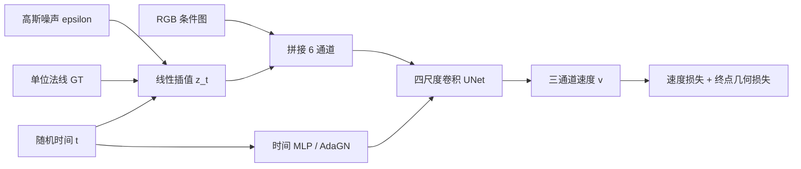
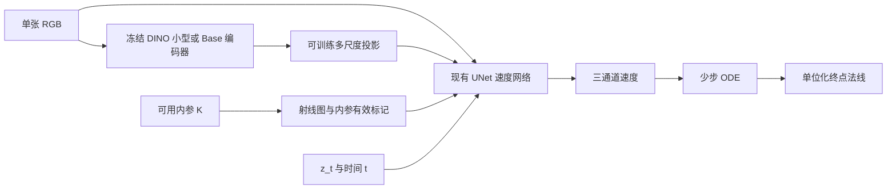

# 从 FaceFlux 到通用物体与场景法线：代码审计、文献与研究方案

研究日期：2026-10-21。目标：单张 RGB → 可见表面的相机坐标系法线，兼顾单个物体与完整场景；训练资源约单卡 24GB；保留 flow matching。

本文将代码事实、文献已有方法和待验证方案分开。代码结论来自当前工作目录与已有实验记录；本次没有重新训练或测量模型。文献主窗口为 2024-10-21—2026-10-21，另列窗口外的必要基础论文。检索覆盖单目法线、几何密集预测、flow matching 与邻近多视图工作，不是穷尽性查新，也不构成首创证明。

## 1. 建议先做什么

推荐先建立 **冻结的通用视觉编码器 + 现有像素空间速度 UNet + 相机射线条件 + 物体/场景混合监督** 的基线，严格保留原来的高斯起点、线性插值、随机时间、速度匹配和 ODE 推理。

随后把研究问题收敛到：**在物体细节与场景整体几何之间，如何通过可靠的几何监督，使一个小型条件 flow 在未见类别、光照、材质和相机条件下保持准确与一致？**

优先级为：标签与评测规范 → 跨域数据 → 预训练条件 → CFG/步数消融 → 几何与细节约束 → 更复杂的概率路径。当前证据不支持把主要精力继续放在原人脸数据上调 dropout 和 cosine 权重。

已有工作已经覆盖“FM 做通用法线”“DINO 条件”“粗到细 FM”。这些可以是合理组件，但不足以单独作为论文贡献。最直接的对照是 [DiCeption](https://arxiv.org/abs/2502.17157)、[Lotus-2](https://arxiv.org/abs/2512.01030)，以及物体法线方向的 [RoSE](https://arxiv.org/abs/2602.09929)。

## 2. 当前模型实际流程

### 2.1 数据与网络

当前训练日志记录 3,113 对 RGB/normal，UNet-B 参数为 43,081,539；从头训练，没有加载 FLUX 或其他生成模型权重。网络注释中“接近 16.76M”的描述与实际日志不符。[训练日志](../reproducibility/baseline_training_header.txt#L2)

| 环节 | 当前实现 | 通用化时的含义 |
|---|---|---|
| 数据输入 | 同名 RGB 与 normal PNG 配对，256×256 | 尚无多数据源、内参、有效像素或标签置信度协议 |
| 增强 | 随机裁剪、水平翻转；翻转时 normal 的 x 分量取负；RGB 颜色扰动 | 翻转逻辑有几何意识，但还未覆盖不同内参、纵横比与场景尺度 |
| 法线 | RGB 映射到 [-1,1]，训练时逐像素单位化 | 标签生成来源未能由当前代码确认；无效像素也会进入训练 |
| 网络输入 | concat(z_t, RGB)，共 6 通道 | RGB 仅在入口拼接，没有预训练语义条件 |
| 网络主体 | 纯卷积 ADM-style UNet，通道 64/128/256/512 | 256px 输入对应四尺度 256/128/64/32 |
| 时间条件 | sinusoidal embedding + MLP + AdaGN | 仍可完整沿用 |
| 输出 | 3 通道速度场 | 法线终点由状态和速度计算 |

每个尺度的 encoder/decoder 各两个残差块，bottleneck 两个；无 self-attention、无相机 ray、无深度分支。网络实际使用的是降通道残差块加 nearest 上采样。[网络定义](../baseline/src/models/model_unet.py#L181)，[前向计算](../baseline/src/models/model_unet.py#L249)，[数据增强](../baseline/train_unet.py#L41)

### 2.2 Flow matching 与损失

代码采用：

\[
\epsilon\sim\mathcal N(0,I),\quad t\sim U[0,1],\quad
z_t=(1-t)\epsilon+t n,\quad u_t=n-\epsilon.
\]

网络学习 \(v_\theta(z_t,t,I)\)，由当前位置估计终点：

\[
\widetilde n_t=z_t+(1-t)v_\theta(z_t,t,I).
\]

完整损失为：

\[
L=L_{\rm FM}+0.25L_{\rm unit}+0.25L_{\rm cos},
\]
\[
L_{\rm FM}=\operatorname{MSE}(v_\theta,n-\epsilon),\qquad
L_{\rm unit}=\mathbb E(\|\widetilde n_t\|-1)^2,\qquad
L_{\rm cos}=\mathbb E[1-\cos(\widetilde n_t,n)].
\]

这是欧氏空间直线条件 FM。中间状态不在单位球面上是该设定本身的性质，不是实现错误。`pred_x0` 变量实际上代表 t=1 的法线终点；所谓 angular 项实际为 cosine，不是 arccos 角误差。[FM 训练](../baseline/train_unet.py#L275)，[完整损失](../baseline/train_unet.py#L195)

当前所有项全图平均，无 valid mask。物体背景、深度孔洞、天空等无标注位置必须屏蔽，不能把黑色 normal 编码解成 (-1,-1,-1) 后当有效法线。

### 2.3 训练与推理

配置为 AdamW、学习率 1e-4、500 epochs、FP16、batch 8、梯度积累 2。CFG dropout=0.5，而且是每个 batch 抽一次是否丢弃 RGB。当前训练主循环只保存权重，没有调用文件内已定义的 evaluate，也没有验证集选模机制、EMA 或学习率计划。[配置](../baseline/configs/best_reproduction.yaml#L6)，[训练循环](../baseline/train_unet.py#L234)

正式推理入口复用评测文件，当前默认是 1 步 Euler + Geom-CFG + no-TTA。因此 **1 步对应 2 次 UNet 前向**；`no_cfg` 才是一次纯条件前向。[推理入口](../baseline/scripts/inference/inference_unet.py#L128)

Geom-CFG 的实际权重为：

\[
s=\operatorname{clip}(1.5\cos(\widehat n_c,\widehat n_u),0,1.5),\quad
v=v_u+s(v_c-v_u).
\]

若两种预测夹角达到 90°，s=0，完全采用无条件输出。对于人脸以外的新几何，存在被训练域先验牵制的机制风险；这是待实验验证的判断，不是已经测到的 OOD 失败。[实现](../baseline/scripts/eval/eval_facescape_modes.py#L274)

共享推理的步长现为正确的 \(t_k=k/K,\Delta t=1/K\)。训练文件内未调用的旧多步 infer 函数仍有累计时间超过 1 的问题，应在将来统一入口时清理；不能把它误报为当前默认 1 步推理错误。[共享步长](../baseline/scripts/eval/eval_facescape_modes.py#L258)，[旧函数](../baseline/train_unet.py#L85)

当前输出逐通道 clamp 后编码 PNG，评测再归一化。先 clamp 后 normalize 可能改变方向；新协议应保存单位化的浮点 normals，PNG 仅作显示或交换格式。[输出处理](../baseline/scripts/eval/eval_facescape_modes.py#L335)

### 2.4 已有结果可以支持什么

最佳已有记录为 17.8995±2.1657°，共 1998 张；<20° 为 63.62%，<25° 为 78.82%，<30° 为 88.89%。这里 std 是各图平均误差之间的标准差，不是独立训练重复的误差条。[结果汇总](../baseline/results/historical_summary.md#L7)

评测使用 dlib 人脸凸包与处理后的 GT mask；38 张回退到 GT 前景。25×25 closing 和 5×5 erosion 会影响边界统计，不适合直接沿用到椅子腿、细枝、线缆等通用结构。现有结果只能说明这一人脸协议下的表现。[评测与 mask](../baseline/scripts/eval/eval_facescape_modes.py#L434)

此外 p=0 模型用 no-CFG，其余模型用 Geom-CFG，当前表格并非只改变训练 dropout 的严格消融。`no_flow` 仍保留随机状态与时间，只去除速度 MSE，也不等价于标准确定性回归模型。

## 3. 近两年文献：哪些最值得看

下表的“可借鉴”是面向本项目的推论，不表示论文已经验证本项目中的组合。不同论文数据和评测协议不一致，本文不拼接数值做跨论文排名。

| 工作与时间 | 已有方法及与本项目的关系 |
|---|---|
| [Neural LightRig: Unlocking Accurate Object Normal and Material Estimation with Multi-Light Diffusion](https://arxiv.org/abs/2412.09593)，首发 2024-12，CVPR 2025 | 从单图生成多光照观测，再恢复法线与材质；提供 LightProp。启发材质/照明与几何分离，且是直接物体级相关工作。完整生成链路不宜作为 24GB 第一版。 |
| [DICEPTION: A Generalist Diffusion Model for Visual Perceptual Tasks](https://arxiv.org/abs/2502.17157)，2025-02-24，NeurIPS 2025 | SD3/FM 多任务感知，包含法线。它直接覆盖“用 FM 做通用法线”的概念，应作为最接近工作；任务提示与 RGB-like 输出本身没有足够新颖性。 |
| [Hi3DGen: High-fidelity 3D Geometry Generation from Images via Normal Bridging](https://arxiv.org/abs/2503.22236)，2025-03-28，ICCV 2025 | NiRNE 模块用 clean/noisy 双流以及真实/合成分阶段训练获取物体法线。可借鉴数据质量与结构/细节分工；NiRNE 本身不是当前形式的 FM。 |
| [NormalCrafter: Learning Temporally Consistent Normals from Video Diffusion Priors](https://arxiv.org/abs/2504.11427)，2025-04-15，ICCV 2025 | 视频扩散、DINOv2 特征正则、latent/pixel 两阶段训练。说明语义对齐和像素监督已有依据；当前单图任务可只借训练监督，不必引入视频骨干。 |
| [Marigold: Affordable Adaptation of Diffusion-Based Image Generators for Image Analysis](https://arxiv.org/abs/2505.09358)，2025-05-14，TPAMI 2025 | Marigold 扩展至法线等任务，合成数据配生成先验，VAE 解码法线后单位化。可作为通用场景的扩散基线，不能与原始仅深度版混淆。 |
| [MoGe-2: Accurate Monocular Geometry with Metric Scale and Sharp Details](https://arxiv.org/abs/2507.02546)，2025-07-03，NeurIPS 2025 | 关注几何、细节与混合数据监督。官方 normal head 在投稿后新增，使用 depth+K 导出的监督；不是原论文声称的新核心模块。见[官方说明](https://github.com/microsoft/MoGe/blob/main/docs/normal.md)。 |
| [From Editor to Dense Geometry Estimator（FE2E）](https://arxiv.org/abs/2509.04338)，2025-09-04，CVPR 2026 | 从图像编辑 DiT 适配，联合深度法线，consistent velocity 简化为确定性预测。是强对照，但若要求保留完整随机路径 FM，不宜照搬其最终训练定义。 |
| [Lotus-2: Advancing Geometric Dense Prediction with Powerful Image Generative Model](https://arxiv.org/abs/2512.01030)，2025-11-30，预印本 | 单步 coarse predictor，再用无噪声 rectified flow 做细节精修。与“粗法线→精法线 FM”直接重合。论文使用的 manifold 描述并不等于法线单位球面的显式黎曼流。 |
| [TransNormal: Dense Visual Semantics for Diffusion-based Transparent Object Normal Estimation](https://proceedings.mlr.press/v306/li26ao.html)，首稿 2026-01-31，ICML 2026 | DINOv3 密集语义经 cross-attention 注入，配多任务与小波约束，研究透明物体。说明仅“DINO 注入＋边缘损失”已有先例；透明物体应独立分组测。 |
| [Monocular Normal Estimation via Shading Sequence Estimation（RoSE）](https://arxiv.org/abs/2602.09929)，2026-02-10，ICLR 2026 | 从单张 RGB 预测规范光照 shading 序列，解析解回法线。对于物体法线，应重视它对几何细节与外观混淆的研究；测试不要求真实拍多光照。 |
| [Any Resolution Any Geometry: From Multi-View To Multi-Patch](https://dreamaker-mrc.github.io/Any-Resolution-Any-Geometry/)，CVPR 2026 | 借多 patch 组织、粗几何条件、跨 patch 交互处理高分辨率。可启发全图条件＋局部细节，但跨 patch 注意力和高分辨率拼接本身不是新的。 |
| [Marigold V2: Revisiting Diffusion Transformers for Monocular Depth Estimation](https://arxiv.org/abs/2609.08084)，2026-09-08，已公开；官方标记 TOG/SIGGRAPH Asia 2026 待刊 | 编辑 DiT、QLoRA、iREPA 和局部 Sinkhorn 监督，也包含法线。固定时间后实为直接 latent 回归，无需积分轨迹。可借监督和标注错位处理，不能称为完整保留当前 FM。 |

阅读优先顺序：Lotus-2/DiCeption（确认重合边界）→ RoSE/NiRNE（物体几何与材质）→ Marigold V2/NormalCrafter（监督与细节）→ DSINE（相机几何）→ 其余比较。

### 3.1 窗口外仍需引用的基础

| 文献 | 作用 |
|---|---|
| [DSINE: Rethinking Inductive Biases for Surface Normal Estimation](https://arxiv.org/abs/2403.00712)，2024-03-01，CVPR 2024 | 每像素射线和邻域法线相对旋转，支持加入法线特定的几何归纳偏置。 |
| [GenPercept: What Matters When Repurposing Diffusion Models for General Dense Perception Tasks?](https://arxiv.org/abs/2403.06090)，2024-03-10，ICLR 2025 | 高质量数据、像素任务损失与确定性单步适配；首稿早于窗口，2024-10 有重要修订。 |
| [GeoWizard](https://arxiv.org/abs/2403.12013)，2024-03-18，ECCV 2024 | 联合深度/法线与预训练生成先验已有先例。 |
| [DepthFM](https://arxiv.org/abs/2403.13788)，2024-03-20，AAAI 2025 | 图像到深度的 flow matching，不能声称首次将 FM 用于图像几何。 |
| [StableNormal](https://arxiv.org/abs/2406.16864)，2024-06-24，SIGGRAPH Asia 2024 | 稳定初始化和语义引导精修，说明稳定性/锐利度及粗到细已有充分研究。 |
| [Lotus](https://arxiv.org/abs/2409.18124)，2024-09-26，ICLR 2025 | 单步 clean target 与 detail preserver；不能把其扩散实验推成所有 FM 多步无效。 |
| [Flow Matching on General Geometries](https://arxiv.org/abs/2302.03660)，2023 首稿，ICLR 2024 | 球面/流形 FM 的理论起点，并非法线任务专门论文。 |

邻近但不同输入协议的工作：[Surflo](https://arxiv.org/abs/2606.13644) 是多视图三维表面 flow；[GeoStereo](https://arxiv.org/abs/2607.24024) 需要立体图像；[FlashNormal](https://arxiv.org/abs/2608.25360) 使用 flash/no-flash 对。它们提供几何或照明思路，不应和单张 RGB 直接混成同一公平评测。

## 4. 方案 A：最适合先落地的原路径 FM 基线

### 4.1 结构

- 保留现有高分辨率卷积分支，让它负责位置和局部细节；冻结的 DINO 提供更广泛的语义与整体形状线索。
- 从多个 transformer 层取特征，经轻量投影重采样到 UNet 的 1/4、1/8 等尺度。ViT 的不同层通常是同一空间分辨率，不能把它们直接叫天然多尺度金字塔。
- 先用加法/拼接 adapter，低分辨率 cross-attention 留作消融。图像条件只编码一次，各 ODE 步复用。
- 初版冻结全部视觉编码器，训练 UNet 与 adapter；以后再比较少量末层微调。小型 DINOv2 或 DINOv3 可选，不把“用最新版”当保证。模型与权重以[官方 DINOv2](https://github.com/facebookresearch/dinov2)和[官方 DINOv3](https://github.com/facebookresearch/dinov3)为准。
- 对有 K 的数据计算 \(r(p)=\operatorname{normalize}(K^{-1}[u,v,1]^T)\)。crop/resize 同步修改 K。对未知 K 的普通图像，应提供缺失标记并训练相应退化分支，不能假装精确内参已知。

这条路线保留的不只是“flow”名字：仍采样所有时间，仍构建带噪状态，仍学习速度，仍可积分多个时间步。

### 4.2 最小损失

\[
L_0=L_{\rm FM}^{M}+\lambda_aL_{\rm cos}^{M}+\lambda_uL_{\rm unit}^{M},
\]

其中 M 为有效几何标签掩膜。优先修正 mask 和归一化，再加入额外项。单位长度项作用于未 normalize 的终点估计，否则恒为零。

初版不要同时加十种损失。以现有 0.25 为可复现起点，随各项梯度量级调整；“所有新项都设 0.1”没有依据。

### 4.3 24GB 训练起点

| 项目 | 建议起点 | 限定 |
|---|---|---|
| 分辨率 | 256 做流程和消融，随后 384/512 的全图或 patch | 具体显存要实测；不能承诺 batch 大小 |
| batch | 从 1–2 测峰值，再梯度积累到有效 8–16 | 成对训练计算两张图，计入真实开销 |
| 精度 | GPU 支持时使用 BF16，否则 FP16；几何归一化/角度等用 FP32 | 角度训练可用稳定 cosine，报告角误差用 clamp 后 arccos |
| 显存 | 冻结编码器、activation checkpointing | 条件特征可按图复用，缓存须与增强一致 |
| CFG | 初版纯条件，再独立比较 dropout/CFG | 不预先断言 p=0 最好 |
| 步数 | 1/2/4/8 步 | 同时报告前向次数、延迟和峰值显存 |
| 初始权重 | 人脸 checkpoint 微调 vs 随机 UNet；冻结条件相同 | 检查人脸先验是帮助还是负迁移 |

Marigold V2 官方展示的是单张 32GB GPU 的适配范例，不能据此保证 24GB 能原样训练；本项目先用小型条件编码器的方案更便于消融。[原文](https://arxiv.org/html/2609.08084v1)

## 5. 方案 B：推荐的研究主线——可靠几何监督下的跨域 FM

方案 A 是必要基线。更有研究价值的问题是：真实场景标签常有边缘噪声，物体合成标签细节更干净；如何让 flow 同时学到场景结构与物体细节，且不把纹理、阴影学成凹凸。

建议从以下模块中逐一验证，而不是全部直接叠加。

### 5.1 根据监督来源分配几何与细节约束

对高质量渲染 normals 使用像素角度和局部法线变化监督；对由真实深度派生的 normals，用深度有效性、邻域平面残差与深度断层生成可靠性权重，避免将边界噪声硬蒸馏进模型。

可比较局部法线差分：

\[
L_{\Delta n}=\frac{\sum_{(p,q)}w_{pq}\|[(\hat n_p-\hat n_q)-(n_p-n_q)]\|_1}{\sum_{(p,q)}w_{pq}+\varepsilon}.
\]

这里是匹配真实几何变化，不是无条件压小梯度。光照和纹理边缘未必是几何边缘，不能仅靠 RGB 梯度把某些位置指定为“应当锐利”。真实数据上 w 需屏蔽不可靠断层；合成数据可保留清晰边界单独监督。

如果引入预测深度，使用相机反投影：

\[
P(u,v)=D(u,v)K^{-1}[u,v,1]^T,\quad
n_D=\operatorname{normalize}(\partial_uP\times\partial_vP),
\]

上述反投影公式要求 D 为相机 z-depth。若数据给的是沿射线的距离/range，则应使用 \(P=D\operatorname{normalize}(K^{-1}[u,v,1]^T)\)，或先换算为 z-depth；不同数据源必须先统一这一定义。

再按统一法线朝向设置符号，加入可靠区域的 cosine 一致性。深度头必须有监督/锚点；只让两个无监督输出彼此一致可能得到共同错误。对强反光、透明边界、深度孔洞、法线贴图引入的微细节，应减弱或取消深度一致性。不要把不带 K 的 \((-D_x,-D_y,1)\) 当通用透视公式。

这条思路受到 NiRNE 和 MoGe-2 的监督质量讨论启发，但是否优于普通置信度加权必须由同数据、同骨干的实验回答。[NiRNE](https://arxiv.org/html/2503.22236v2)，[MoGe-2](https://arxiv.org/abs/2507.02546)

### 5.2 训练多视图，推理仍单图

用已知深度、相机和可见性，将同一三维表面在两视图的法线对应起来：

\[
L_{\rm mv}=\mathbb E_{p\in V}\left[1-\langle R_{ji}\hat n_i(p),\hat n_j(W_{ij}(p))\rangle\right].
\]

W 是几何重投影，V 包括有效深度、遮挡和边界筛选。法线只受旋转影响，不受平移直接影响；像素对应关系却同时受旋转和平移影响。未经旋转就比较两个相机的 normals 是错误的。

先将它作用于 flow 估计的终点，便于保留原 FM 路径。若进一步研究整个速度场的跨视图协变，噪声和中间状态也必须按对应关系耦合；随意 bilinear warp 独立高斯场会改变方差与相关性，不能直接声称理论等变。

创新需要体现在可靠性建模、约束如何进入 flow、以及跨类别/跨域的实证增益。多视图一致性本身已是成熟思路，并不自动新颖。

### 5.3 光照/材质一致性：值得做，但不能夸大

对同几何、同视角的不同光照或材质渲染 \(I_a,I_b\)，共享 n、epsilon 和 t，可加入速度一致性 \(L_{pair}=\|v_a-v_b\|^2\)。它保留原 FM，并直接针对外观变化。

但设 \(y=n-\epsilon,m=(v_a+v_b)/2\)，有：

\[
\tfrac12(\|v_a-y\|^2+\|v_b-y\|^2)
=\|m-y\|^2+\tfrac14\|v_a-v_b\|^2.
\]

所以额外 pair loss 本质上提高了对内速度方差的权重，没有凭空增加标签信息。应与“同样数量成对数据、无 pair loss”的模型比较，不能仅凭公式声称提出全新 FM。材质随机化也应保持几何标签定义一致；若修改 bump/normal map，不能继续声称 GT 完全不变。

RoSE 启发可以从终点法线生成 \(s_k=\max(0,\ell_k^T\hat n)\) 做 shading 辅助监督。但线性版本满足：

\[
\|L\hat n-Ln\|^2=(\hat n-n)^TL^TL(\hat n-n).
\]

当 \(L^TL=cI\)，它仅是 normal L2 的倍数；单位法线下又等价于 cosine 项。clamp、梯度或边缘加权可改变优化，但仍须证明实际收益，不能把重复损失当物理新信息。[RoSE 方法](https://arxiv.org/html/2602.09929v5)

### 5.4 建议的论文定位

可暂定为“面向物体与场景统一法线估计的几何一致条件 Flow Matching”。真正需要成立的贡献应是一个具体机制，例如在不同质量监督下约束 flow 终点/轨迹的方式，以及它对跨域细节、一致性、效率的可重复收益。

不要同时把 DINO、ray、mask、更多数据、pair loss 全列成五个创新。前四者主要是基线建设；后者也有明确的数学冗余，需要更强的机制与实验证据。

## 6. 方案 C：球面 FM，作为后续高风险方向

法线方向位于 \(S^2\)。可以令起点和终点都是单位方向，构造测地线：

\[
\theta=\arccos(n_0^Tn_1),\quad
n_t=\frac{\sin((1-t)\theta)}{\sin\theta}n_0+
\frac{\sin(t\theta)}{\sin\theta}n_1.
\]

用 \(u_t=\partial_tn_t\) 做监督，并把网络速度投到切平面：

\[
v_\theta(n_t,t,I)=(I_3-n_tn_t^T)f_\theta(n_t,t,I).
\]

这仍是 flow matching，但已改变概率路径、目标速度和积分方式。近重合/近对跖点需稳定分支；从粗法线附近采样时应在切空间加噪并用 ExpMap，推理的起点分布要与训练一致。理论基础来自 [Riemannian FM](https://arxiv.org/abs/2302.03660)。

潜在价值：法线固有几何、单位长度与大角度变化处理更自然。主要风险：单位长度不等于可积的三维曲面；球面约束也不能解决数据覆盖、材质歧义或局部法线之间的不一致；推理步数和数值稳定性未必胜过欧氏基线。

**不能在现有欧氏 FM 每步简单 normalize，然后继续用原速度目标，声称没有改变问题。** 建议只在方案 A/B 已有稳定跨域表现后做这条研究。

## 7. 数据设计：物体、室内、室外都要有

| 用途 | 可用来源 | 处理重点 |
|---|---|---|
| 物体几何与细节 | Objaverse 筛选渲染、LightProp、Hi3DGen/DetailVerse 的可用资源 | 保留 asset ID、视角、材质、照明、normal、mask、depth、K；检查资产重叠 |
| 室内场景 | Hypersim | 使用相机信息和直接几何标签；区分世界法线和相机法线 |
| 室外场景 | Virtual KITTI 2 等具备深度/K 的合成数据 | VKITTI2 不直接提供 normals；由 depth+K 派生并屏蔽断层、无效远景 |
| 真实域校正 | 有可靠深度/几何的室内或室外数据，或离线教师标签 | 区分测量 GT 与伪标签；教师不一致处降低权重；测试集不可用于训练 |

来源：[Objaverse](https://objaverse.allenai.org/objaverse-1.0/)、[LightProp 官方数据](https://huggingface.co/datasets/zxhezexin/NLR-LightProp-Objaverse-Renderings)、[Hypersim 官方仓库](https://github.com/apple-aiml-research/ml-hypersim)、[Virtual KITTI 2 官方介绍](https://europe.naverlabs.com/proxy-virtual-worlds-vkitti-2/)。LightProp 官方包约 696GB 且需申请访问；应先确认可取用子集，不需要第一轮就下载全部。

第一轮可用总计 2–5 万对做验证，物体和场景各约一半，并在场景部分覆盖室内/室外。这是资源受限的实验起点，不是经验证的最优比例。按对象/场景采样，避免同一资产大量相邻视角垄断 batch。验证获益后再扩大覆盖和真实域比例。

统一输出协议至少包含：坐标轴方向、朝向、世界→相机变换、normal 类型、有效 mask、相机内参有效标记。明确学几何法线还是带材质 normal-map 的 shading normals；两者不一致时，深度一致性会出现真实冲突。普通 crop/resize 改的是 K，不应随意按图像宽高比缩放法线分量。

## 8. 评测与消融：先验证是否值得继续

物体组：DiLiGenT、LUCES/LUCES-MV 的单输入协议，以及未见资产/未见类别渲染。虽然一些基准原始数据是多光照或多视图，模型每次只能使用声明的一张输入；聚合指标按物体身份计算，避免把同一物体多张图当独立类别泛化证据。

场景组：NYUv2、ScanNet、iBims-1、DIODE indoor/outdoor；数据集划分与训练来源核对。完整场景能力不能只用室内指标代表。物体 benchmark 的选择也与 [RoSE 的评测](https://arxiv.org/abs/2602.09929)对应，场景基线协议可参考 [Marigold 扩展版](https://arxiv.org/abs/2505.09358)。

统一报告 mean/median angular error、angular RMSE、<11.25°/<22.5°/<30°；另报告边界带、薄结构、平面、反光/透明、不同 FOV、不同噪声种子方差。按数据集和类别分别报告，跨组汇总使用明确的 macro 口径，不让背景或大面积墙面淹没小物体。

| 实验 | 只改变什么 | 要回答的问题 |
|---|---|---|
| E0 | 原模型在新测试集的零样本表现 | 迁移前基线究竟多弱/多强？ |
| E1 | 统一标签、mask、混合数据；保持 UNet/FM | 数据与协议本身带来多少收益？ |
| E2 | E1 + 冻结视觉条件 | 通用先验是否优于仅增加训练样本？ |
| E3 | E2 + ray/K 缺失处理 | 相机与构图变化是否稳定？ |
| E4 | 同训练设置分别测 no-CFG/fixed-CFG/Geom-CFG | 无条件先验的增益和偏置有多大？ |
| E5 | 同 backbone/data 的确定性 normal 回归 | 在这一预算下，保留 FM 的价值体现在哪里？ |
| E6 | 分别加入可靠性、几何差分或多视图约束 | 增益来自哪个机制，有无相互抵消？ |
| E7 | 成对渲染：无 pair loss vs 有 pair loss | 显式一致性是否超出额外数据的收益？ |
| E8 | 全部候选统一比较 1/2/4/8 步 | 改进是否依赖更高计算成本？ |
| E9 | 最优少量配置重复训练、重复推理种子 | 收益是否可重复，随机性是否有害？ |

E5 是对照实验，不是改变主方法的约束。若 FM 只增加成本，却没有更好跨域表现、细节、可校准不确定性或可用的精度/步数权衡，论文必须正视这一结果，不能只保留有利对照。

建议里程碑：先让 E1–E3 在物体和场景两组都改善，再进入复杂几何目标。若只提高单一数据集均值，而边界或另一域变差，应先调整数据质量和采样，不立即扩大网络。FM 多样本方差也不天然等于可信不确定性，需用误差相关性、风险-覆盖曲线等校准验证。

## 9. 后续实现时的改动位置

| 当前文件 | 后续工作 |
|---|---|
| [train_unet.py](../baseline/train_unet.py) | 抽出多域 dataset；加入 mask/K；统一累计梯度末批处理；加入验证选模、完整 checkpoint 状态；保留 FM 核心 |
| [model_unet.py](../baseline/src/models/model_unet.py) | 加可选 condition pyramid、ray adapter；保留 velocity 输出与时间条件 |
| [eval_facescape_modes.py](../baseline/scripts/eval/eval_facescape_modes.py) | 保留人脸历史协议；为通用域另设 evaluator，不能继续依赖 dlib mask |
| [inference_unet.py](../baseline/scripts/inference/inference_unet.py) | 输出浮点单位法线；保纵横比/padding；统一步数与 NFE 报告 |

本次只新增研究文档，未改训练、推理和模型实现。方案 A 是最合适的下一步；方案 B 的具体贡献需要受控实验来筛选；方案 C 是保留 FM 大类但改变路径的后续研究候选。
