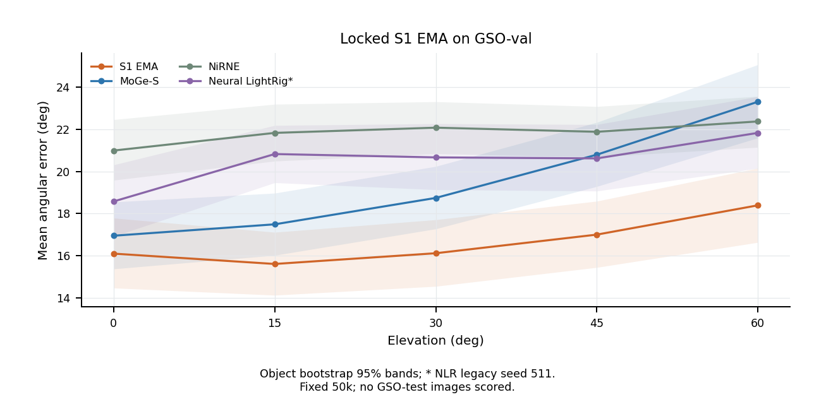

# S1 EMA: completed fixed-50k validation snapshot (2026-11-19)

All four follow-up fits and their five-panel evaluations are complete. The locked checkpoint remains S1 EMA, seed1247, `ebf6a113...`; later seeds quantify variation and do not replace it. GSO-test has not been evaluated.

## S1 training seeds

|Training seed|GSO-val MAE (degrees)|
|---|---:|
|1247|16.637211|
|1248|16.632682|
|1249|16.714228|

Mean **16.661374 degrees**, sample SD **0.045829 degrees** (ddof=1). This SD describes three training seeds, not an inference-seed SD or an object bootstrap interval.

## Five-panel accuracy

|Model / weights|GSO-val|DiLiGenT single|LUCES single|DiLiGenT 10-light|LUCES 10-light|
|---|---:|---:|---:|---:|---:|
|S1_s1247 / EMA|16.637211|17.567863|16.448867|17.681250|15.721574|
|S1_s1248 / EMA|16.632682|17.434992|17.132925|17.493112|16.083410|
|S1_s1249 / EMA|16.714228|17.254716|17.285834|17.415806|15.781080|
|S1_no_distill_s1247 / EMA|17.464355|17.735007|16.887025|18.203265|16.509076|
|B1_s1247 / EMA|16.687133|17.368420|16.994647|17.488706|16.268943|
|S0_s1247 / raw|20.048767|20.240071|18.970721|20.310274|17.942768|

S1/B1 use the initial three-view distillation-plus-EMA recipe. No pitch-balanced sampler or extra prepared view was used. S0 changes encoder training, distillation and EMA together; its gap is not a single-factor attribution. B1 is a completed single-seed comparison. Complete raw/EMA median, thresholds, boundary, pitch and bootstrap statistics are in [model_metrics.json](model_metrics.json), with [CSV](accuracy.csv), [recipes](recipes.json) and [provenance](provenance.json).

## No-distillation control

Same seed1247, fixed50k and EMA. Delta is no-distillation minus locked S1; positive means larger error.

|Panel|MAE delta|Paired object 95% interval|
|---|---:|---|
|GSO-val|+0.827143|[0.585000, 1.081347]|
|DiLiGenT single|+0.167144|[-0.413475, 0.700457]|
|LUCES single|+0.438158|[-0.170721, 0.952883]|
|DiLiGenT 10-light|+0.522014|[0.035561, 0.961423]|
|LUCES 10-light|+0.787502|[0.454928, 1.123209]|

Single-light real-domain intervals cross zero. This is one training-seed ablation, with fixed-weight object-cluster resampling; it does not establish a multi-training-seed ablation result.

## Matched idle RTX3090 batch-1 latency

No training processes were present during these windows. Input/noise/time were GPU-resident, TF32 off, 5 warmups and 30 timed repetitions per process, 3 fresh processes per native model. The reported statistic is the median of process medians, not the fastest repeat. CPU affinity was fixed; CPU occupancy and GPU power/temperature/clock states are retained as per-window numerical summaries.

|Model|Wall median ms|GPU event median ms|
|---|---:|---:|
|S1|65.2995|65.2380|
|MoGe-S|44.8757|44.8184|
|MoGe-B|50.3025|50.2451|
|E1_B|65.5828|65.5247|

S1/E1_B use BF16 autocast and MoGe uses FP16 autocast, with FP32 stored parameters. S1 standalone encoder/head wall times are 34.0673/30.7362ms. S1 compile+channels_last is 45.8425ms and MoGe-S with the same optimization is35.2501ms, excluding first compile. S1 optimized output differs from native by mean0.362525 degrees on the timing input; this is output-vs-output drift, not GT error. Full optimized accuracy is not verified, so its speed is not combined with native accuracy.

Historical low batch1 values remain separate. CPU-affinity ABBA changes E1_B by about3%, insufficient to explain the full historical gap. Old logs also lacked xFormers. Power/thermal slowdown flags were observed in some model windows, but memory-junction temperature was not sampled; the historical root cause remains unresolved. [All measured cases](efficiency_all_methods.json), [idle repeats, telemetry summaries and old/new comparison](training_free_latency.json), [lower-resolution trade-offs](lower_resolution_accuracy.json). Neural LightRig native FP32/75-step graph was parity-checked before timing; full30-repetition median87.1370seconds. Unsupported batch cases are explicit.

## Protocol separation and coverage

[New42-49 baseline table](new42_49_baselines.json) and [legacy-protocol reproduction](legacy_protocol_metrics.json) are distinct. Neural LightRig quality remains legacy511. [Inference variants](inference_variants.json) retain random as the registered default; no best noise seed is selected. [Protocol](protocol.json) records the common-mask, object-equal and pitch-equal aggregation and the external data prerequisites. Each final variant has all2124 images:1860GSO-val,10/14 single-light real,100/140 ten-light real.

The curve uses object-bootstrap95% bands; NLR is marked as legacy511. It is not a paired significance plot; paired intervals are in the JSON. No RGB, normal predictions, data, manifests or checkpoints are part of this snapshot. Original hashes and normalized exported hashes are distinguished in the publication manifest. Failed numerical/parity/operational attempts remain recorded locally; the aggregate validation report records the completed-scope checks. No GSO-test scores are included.

## Reproduction code

See [reproduction instructions](../../reproducibility/icme2027_20261119/README.md). The exported configurations create fresh signed runs, not replacements for historical checkpoint signatures.
